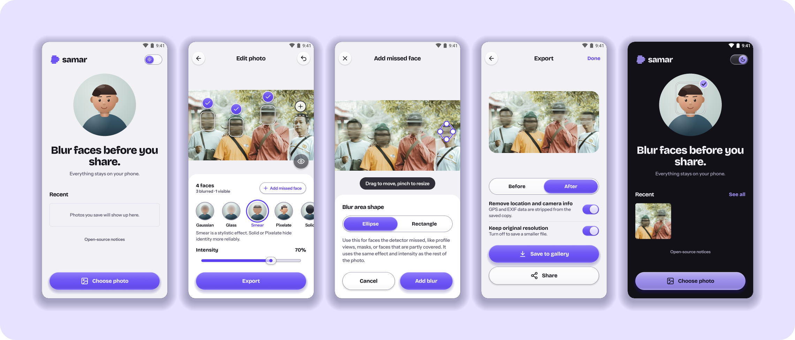
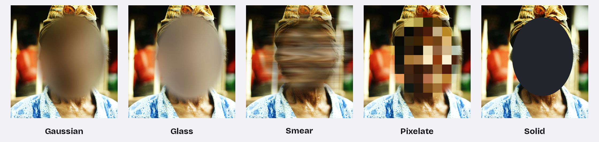
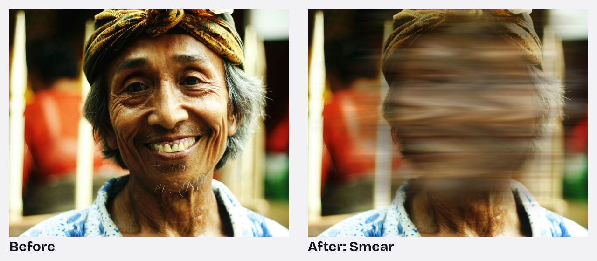

<div align="center">


# samar

**Blur faces before you share.**<br>
Everything stays on your phone.

<sub><i>samar</i> (Indonesian): faint, indistinct, hard to make out.</sub>

<br>

[**Download for Android**](https://github.com/hystericmoon/samar/releases/latest) &nbsp;·&nbsp; Android 8.0 or newer &nbsp;·&nbsp; Photos never leave your phone

<br>



<br>


https://github.com/user-attachments/assets/f906472c-0703-4918-8402-f40d56a0afd8


</div>

<br>

## Why samar

You took a photo with friends, strangers or kids in it, and you want to share it without showing their faces. samar finds the faces, hides them and saves a clean copy, without the photo ever leaving your phone.

| | |
|---|---|
| 🔒 **Fully on-device** | Faces are found with Google's ML Kit model, which is *bundled inside the app*. Photos are never uploaded; the only connection samar makes is to GitHub, to check for its own updates. |
| 🧭 **No tracking** | No accounts, no analytics, no ads, no uploads. |
| 🧹 **Clean copies** | Saved photos have location and camera info (EXIF, GPS) removed by default. |
| 🎨 **Five looks** | Gaussian, Glass, Smear, Pixelate and Solid, with one intensity slider. |
| ✋ **You stay in control** | Auto blurs every face it finds; Manual lets you pick. Resize any blur, keep faces visible, or draw over one the detector missed. |
| 🌗 **Light and dark** | Follows your phone, or switch it with the moon button on Home. |
| 🔄 **Stays up to date** | Checks GitHub once a day for a new version and updates in two taps. You can turn this off. |

<br>

## Five effects



Every effect except Solid fades softly into the hair and skin around the face, so the result looks natural rather than cut out. Its strength scales with each face's size, so what you see in the preview is what gets saved.

- **Gaussian**: a soft blur.
- **Glass**: frosted blur with a light white tint.
- **Smear**: a long-exposure "head shake". The head streaks sideways in fine lines and fades into the background.
- **Pixelate**: a blocky mosaic.
- **Solid**: a flat, hard-edged cover in charcoal, black, white, navy or neon. Always fully opaque.



> [!NOTE]
> Smear is a stylistic effect. **Solid** or **Pixelate** hide identity more reliably.

<br>

## How to use

1. **Choose photo.** Tap *Choose photo* on Home and pick an image. samar opens it in the editor and finds the faces.
2. **Check the faces.** Each face gets a box and a round toggle above it. A ✓ means it will be hidden; tap it to switch to ＋ and keep that face visible. Pinch or double-tap to zoom in on small faces.
3. **Pick a look.** Scroll the effect row and drag *Intensity* until you're happy (with *Solid*, pick a colour instead). Tap the 👁 button on the photo to compare with the original, or ▢ to hide the boxes and preview the result.
4. **Add a missed face** if needed. Tap *Add missed face*, drag the shape over the face (pinch or use the handles to resize, switch between Ellipse and Rectangle), then tap *Add blur*. Undo is in the top-right corner.
5. **Export.** Check *Before / After*, then tap **Save to gallery** (it goes to `Pictures/samar`) or **Share**.

Tap a face's box to **adjust its blur**: drag the handles to make it bigger or smaller, then tap *Update blur*. Use **Select faces → Manual** to start with nothing blurred and pick faces yourself, and the ▢ **Preview** button on the photo to hide the boxes and see the result.

Saved photos appear under *Recent* on Home. Tap one to reopen it with your edits, or use *See all → Edit* to remove items. Removing from Recent never deletes the copy in your gallery.

<br>

## Install

samar isn't on Google Play yet. To install it from GitHub:

1. On your Android phone, open the [latest release](https://github.com/hystericmoon/samar/releases/latest) and download **`samar-1.2.apk`**.
2. Open the downloaded file. If Android asks, allow your browser or Files app to *install unknown apps*. You can turn this off again afterwards.
3. Tap **Install**. Google Play Protect may say it doesn't recognise the app, because it isn't from the Play Store. Choose **Install anyway**.

Needs Android 8.0 (Oreo) or newer. On Android 8 and 9, samar asks for storage access the first time you save, since those versions need it to write to *Pictures*.

<details>
<summary><b>Check the download (optional)</b></summary>

<br>

Each release lists the APK's SHA-256 fingerprint. On a computer, run `shasum -a 256 samar-1.2.apk` and compare.

The APK is signed with this certificate (SHA-256):

```
A6:79:71:9D:2B:18:07:2E:C5:63:03:25:7F:E2:A5:3C:A8:3E:E1:6D:3F:3E:68:D3:C4:DF:9E:E5:EB:6E:ED:23
```

</details>

<br>

## Build from source

Kotlin and Jetpack Compose, built with Gradle. minSdk 26, targetSdk 37.

```bash
git clone https://github.com/hystericmoon/samar.git
cd samar
./gradlew :app:assembleDebug
```

Open the folder in Android Studio to run it on a phone or emulator. Release builds are signed with a key kept outside this repository; without it, `assembleRelease` produces an unsigned APK.

<details>
<summary><b>Where things are</b></summary>

<br>

| Path | What it does |
|---|---|
| `app/src/main/java/app/samar/editor/` | Loading photos, finding faces (ML Kit), the editor's state |
| `app/src/main/java/app/samar/effects/` | The five effects; Smear runs as an AGSL shader on Android 13+ and on the CPU on older phones |
| `app/src/main/java/app/samar/export/` | Saving and sharing, metadata removal |
| `app/src/main/java/app/samar/ui/` | Screens and components (EffectSwatch, FaceToggle, RecentGrid, ThemeSwitch…) |
| `app/src/main/java/app/samar/ui/components/Glass.kt` | The liquid-glass material |

</details>

<br>

## Privacy

samar doesn't collect, store or send any data. Photos are read only when you pick them and are processed in memory on your phone. The *Recent* list (small blurred thumbnails and your edits) is stored privately on your phone and is removed when you clear it or uninstall the app.

**Updates.** Once a day, samar asks GitHub's public API for the latest samar release. That request contains nothing about you or your photos; GitHub sees an ordinary request, like opening the releases page. If there's a newer version, a banner appears on Home. The download is checked (it must be samar, newer, and signed with the same key) before Android's installer opens and asks you to confirm. Turn automatic checks off in *Home → ⓘ About samar*. To update now, open *About samar* and tap *Check for updates*.

**ML Kit.** ML Kit includes a usage-logging component. samar removes the route it would upload through, so it has nowhere to send anything.

<br>

## Credits

- Fonts: Bricolage Grotesque and Instrument Sans, under the [SIL Open Font License 1.1](app/src/main/res/raw).
- Face detection: [Google ML Kit](https://developers.google.com/ml-kit/vision/face-detection) (bundled model).
- Every library's licence is listed in the app under *Home → ⓘ About samar → Open-source notices*.
- Photos in this README are from Unsplash, free to use under the [Unsplash License](https://unsplash.com/license): [four friends](https://unsplash.com/photos/four-men-pose-for-a-photo-outside-LNoV6ykJUPo) by setengah limasore and [portrait](https://unsplash.com/photos/man-wearing-turban-smiling-au84UJ1KmNU) by gede adhiputra.

## Licence

Copyright 2026 Hosni Rachmani. Licensed under the [Apache License 2.0](LICENSE).
